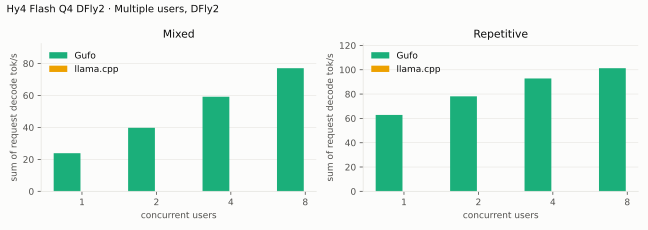

# Benchmarks

AMD Strix Halo `gfx1151`, 128 GB unified memory. Xylolabs `Q4_K_M` GGUF
target, Tencent DFly2 drafter. HTTP, greedy, thinking off. Gufo `0a473ebf`
with this extension at `22d0e06` (November 21, 2026); llama.cpp PR #32517
(`cf70454a6`), which has no DFly2, so its DFly2 columns are its plain
decoding. Positive gain favors Gufo.

## Single user, autoregressive

Approximately pp2048 / tg128; depth is the cached prefix in tokens.
llama.cpp was measured at depths 0, 8,192 and 32,768 only.

<!-- bench:single-ar -->
| Hy4 Flash Q4 AR Depth (tokens) | Gufo pp (tok/s) | llama.cpp pp (tok/s) | Gain | Gufo tg (tok/s) | llama.cpp tg (tok/s) | Gain |
| ---: | ---: | ---: | ---: | ---: | ---: | ---: |
| 0 | 872.20 | 295.76 | +194.9% | 18.83 | 15.05 | +25.1% |
| 4,096 | 825.72 | — | — | 18.86 | — | — |
| 8,192 | 816.56 | 225.91 | +261.5% | 18.81 | 15.11 | +24.5% |
| 16,384 | 796.51 | — | — | 18.75 | — | — |
| 32,768 | 761.97 | 134.15 | +468.0% | 18.60 | 14.16 | +31.4% |
<!-- /bench -->

## Single user, DFly2

The repetitive column asks the model to copy the new turn's passage verbatim
(the harness's `copy` task). The earlier "repeat the passage above" prompt is
ambiguous behind a cached turn: at depth 4,096 the model stopped at EOS before
128 tokens. The multi-user table below keeps that prompt, which completes.

<!-- bench:single-dfly -->
| Hy4 Flash Q4 DFly2 Depth (tokens) | Gufo pp (tok/s) | Gufo tg mixed (tok/s) | llama.cpp AR tg mixed (tok/s) | Gain mixed | Gufo tg repetitive (tok/s) | llama.cpp AR tg repetitive (tok/s) | Gain repetitive |
| ---: | ---: | ---: | ---: | ---: | ---: | ---: | ---: |
| 0 | 870.17 | 24.19 | 15.05 | +60.7% | 67.86 | 15.05 | +350.9% |
| 4,096 | 829.06 | 28.00 | — | — | 61.59 | — | — |
| 8,192 | 821.18 | 24.59 | 15.11 | +62.7% | 67.46 | 15.11 | +346.5% |
| 16,384 | 798.23 | 23.90 | — | — | 68.08 | — | — |
| 32,768 | 761.78 | 24.22 | 14.16 | +71.0% | 65.33 | 14.16 | +361.4% |
<!-- /bench -->

## Multiple users, autoregressive

Same pp2048 prose prompt as single-user d0, tg128, context 4096 per user.
All sessions prefilled before timed decoding; throughput sums the requests'
decode rates. Gufo decodes the sessions together in one pass
([E48](EXPERIMENTS.md#e48-several-sessions-decoding-in-one-pass-2026-11-20)),
with every reply identical to the single-user one.

<!-- bench:multi-ar -->
| Hy4 Flash Q4 AR Users | Gufo AR (tok/s) | llama.cpp AR (tok/s) | Gain |
| ---: | ---: | ---: | ---: |
| 1 | 18.84 | 15.70 | +20.0% |
| 2 | 33.89 | 27.53 | +23.1% |
| 4 | 56.81 | 42.76 | +32.9% |
| 8 | 85.39 | 65.22 | +30.9% |
<!-- /bench -->

## Multiple users, DFly2

As above, mixed and repetitive prompts. The sessions share one drafter pass
([E49](EXPERIMENTS.md#e49-several-sessions-drafts-in-one-drafter-pass-2026-11-20))
and one verify pass of at most 16 rows, so each of n sessions proposes at most
16/n − 1 drafts: from eight users on, plain decoding is faster on prose.
llama.cpp has no DFly2; compare with its AR row above.

<!-- bench:multi-dfly -->
| Hy4 Flash Q4 DFly2 Users | Gufo mixed (tok/s) | llama.cpp mixed (tok/s) | Gain | Gufo repetitive (tok/s) | llama.cpp repetitive (tok/s) | Gain |
| ---: | ---: | ---: | ---: | ---: | ---: | ---: |
| 1 | 23.87 | — | — | 62.85 | — | — |
| 2 | 39.73 | — | — | 78.11 | — | — |
| 4 | 59.19 | — | — | 92.83 | — | — |
| 8 | 77.03 | — | — | 101.26 | — | — |
<!-- /bench -->

## Loading time

<!-- bench:loading -->
| Hy4 Flash Q4 Target | Gufo ready (s) | llama.cpp ready (s) | Gain |
| --- | ---: | ---: | ---: |
| Q4_K_M | 21.61 | 20.02 | -7.4% |
<!-- /bench -->

## Memory occupation

Measured at `22d0e06`. Peak device memory in use during the
request. Gufo's figure includes its vision tower (1.05 GiB) and RAM prompt
cache pages (2.1 GiB), which the llama.cpp run does without; the 16K row's
4,096-token prompt maps the 5.6 GiB of wide prefill rows for its passes.

<!-- bench:memory -->
| Hy4 Flash Q4 AR Workload | Gufo GiB | llama.cpp GiB | Gain |
| --- | ---: | ---: | ---: |
| pp2048 + tg128 | 102.54 | 95.88 | -6.5% |
| 16K prefix, pp4096 + tg128 | 108.66 | 95.94 | -11.7% |
<!-- /bench -->

