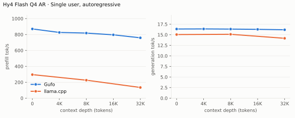
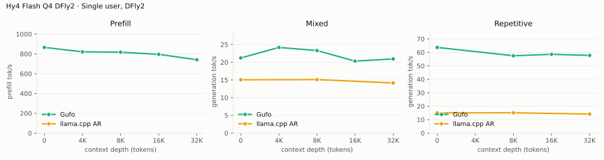
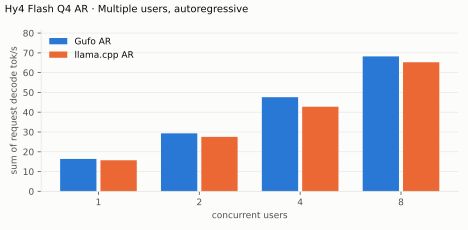
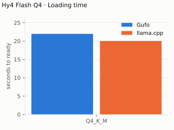
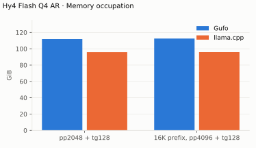

# Benchmarks

AMD Strix Halo `gfx1151`, 128 GB unified memory. Xylolabs `Q4_K_M` GGUF
target, Tencent DFly2 drafter. HTTP, greedy, thinking off. Gufo `0a473ebf`
with this extension at `98e5e24` (November 20, 2026); llama.cpp PR #32517
(`cf70454a6`), which has no DFly2, so its DFly2 columns are its plain
decoding. Positive gain favors Gufo.

## Single user, autoregressive

Approximately pp2048 / tg128; depth is the cached prefix in tokens.
llama.cpp was measured at depths 0, 8,192 and 32,768 only.

<!-- bench:single-ar -->
| Hy4 Flash Q4 AR Depth (tokens) | Gufo pp (tok/s) | llama.cpp pp (tok/s) | Gain | Gufo tg (tok/s) | llama.cpp tg (tok/s) | Gain |
| ---: | ---: | ---: | ---: | ---: | ---: | ---: |
| 0 | 869.99 | 295.76 | +194.2% | 16.36 | 15.05 | +8.7% |
| 4,096 | 825.61 | — | — | 16.38 | — | — |
| 8,192 | 817.72 | 225.91 | +262.0% | 16.34 | 15.11 | +8.1% |
| 16,384 | 795.81 | — | — | 16.28 | — | — |
| 32,768 | 758.38 | 134.15 | +465.3% | 16.18 | 14.16 | +14.3% |
<!-- /bench -->

## Single user, DFly2

The repetitive text at depth 4,096 ends at EOS after 120 of its 128 tokens,
so that row is not measured.

<!-- bench:single-dfly -->
| Hy4 Flash Q4 DFly2 Depth (tokens) | Gufo pp (tok/s) | Gufo tg mixed (tok/s) | llama.cpp AR tg mixed (tok/s) | Gain mixed | Gufo tg repetitive (tok/s) | llama.cpp AR tg repetitive (tok/s) | Gain repetitive |
| ---: | ---: | ---: | ---: | ---: | ---: | ---: | ---: |
| 0 | 865.23 | 21.22 | 15.05 | +41.0% | 63.69 | 15.05 | +323.2% |
| 4,096 | 821.09 | 24.18 | — | — | — | — | — |
| 8,192 | 817.07 | 23.30 | 15.11 | +54.2% | 57.51 | 15.11 | +280.6% |
| 16,384 | 795.56 | 20.32 | — | — | 58.57 | — | — |
| 32,768 | 741.00 | 20.94 | 14.16 | +47.9% | 57.78 | 14.16 | +308.1% |
<!-- /bench -->

## Multiple users, autoregressive

Same pp2048 prose prompt as single-user d0, tg128, context 4096 per user.
All sessions prefilled before timed decoding; throughput sums the requests'
decode rates. Gufo decodes the sessions together in one pass
([E48](EXPERIMENTS.md#e48-several-sessions-decoding-in-one-pass-2026-11-20)),
with every reply identical to the single-user one.

<!-- bench:multi-ar -->
| Hy4 Flash Q4 AR Users | Gufo AR (tok/s) | llama.cpp AR (tok/s) | Gain |
| ---: | ---: | ---: | ---: |
| 1 | 16.37 | 15.70 | +4.3% |
| 2 | 29.32 | 27.53 | +6.5% |
| 4 | 47.59 | 42.76 | +11.3% |
| 8 | 68.21 | 65.22 | +4.6% |
<!-- /bench -->

## Multiple users, DFly2

As above, mixed and repetitive prompts. The sessions share one drafter pass
([E49](EXPERIMENTS.md#e49-several-sessions-drafts-in-one-drafter-pass-2026-11-20))
and one verify pass of at most 16 rows, so each of n sessions proposes at most
16/n − 1 drafts: from eight users on, plain decoding is faster on prose.
llama.cpp has no DFly2; compare with its AR row above.

<!-- bench:multi-dfly -->
| Hy4 Flash Q4 DFly2 Users | Gufo mixed (tok/s) | llama.cpp mixed (tok/s) | Gain | Gufo repetitive (tok/s) | llama.cpp repetitive (tok/s) | Gain |
| ---: | ---: | ---: | ---: | ---: | ---: | ---: |
| 1 | 20.92 | — | — | 59.10 | — | — |
| 2 | 33.66 | — | — | 66.54 | — | — |
| 4 | 48.15 | — | — | 74.13 | — | — |
| 8 | 61.53 | — | — | 74.34 | — | — |
<!-- /bench -->

## Loading time

<!-- bench:loading -->
| Hy4 Flash Q4 Target | Gufo ready (s) | llama.cpp ready (s) | Gain |
| --- | ---: | ---: | ---: |
| Q4_K_M | 21.96 | 20.02 | -8.8% |
<!-- /bench -->

## Memory occupation

Measured at `a64a2fb` (E50, E51). Peak device memory in use during the
request. Gufo's figure includes its vision tower (1.05 GiB) and RAM prompt
cache pages (2.1 GiB), which the llama.cpp run does without; the 16K row's
4,096-token prompt maps the 5.6 GiB of wide prefill rows for its passes.

<!-- bench:memory -->
| Hy4 Flash Q4 AR Workload | Gufo GiB | llama.cpp GiB | Gain |
| --- | ---: | ---: | ---: |
| pp2048 + tg128 | 102.65 | 95.88 | -6.6% |
| 16K prefix, pp4096 + tg128 | 108.77 | 95.94 | -11.8% |
<!-- /bench -->

